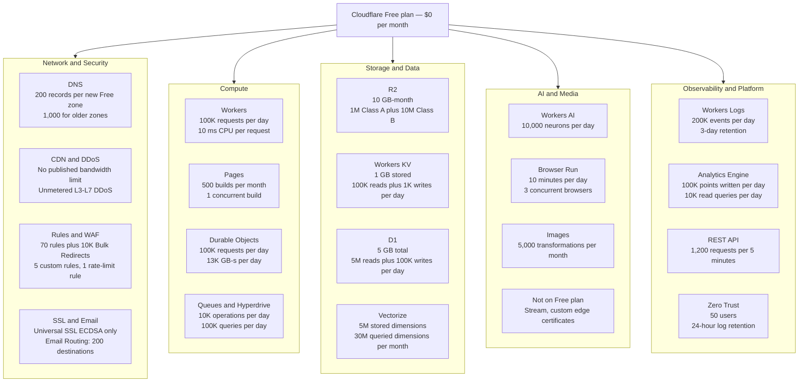

# Cloudflare Free Limits

**Verified:** 2026-11-25  
**Scope:** Documented free allocations on Cloudflare plans and developer products. Paid-only features are marked.

**Method:** Primary sources only — official pricing pages and developer documentation.

Cloudflare changes limits. Check the source links before production use.

## 1. Quick summary

The Free plan includes DNS, CDN, unmetered DDoS protection, Universal SSL, a free WAF ruleset, Workers, Pages, and many developer services. Daily compute limits reset at 00:00 UTC. Most hard caps return an error. They do not create a bill.

Key numbers:

- Workers: **100,000 requests/day**, **10 ms CPU per request**
- R2: **10 GB-month**, **1M Class A + 10M Class B operations/month**
- Workers KV: **1 GB**, **100,000 reads/day**, **1,000 writes/day**
- D1: **5 GB total**, **5M rows read/day**, **100,000 rows written/day**
- Workers AI: **10,000 neurons/day**
- Workers Logs: **200,000 events/day** until 2026-12-01
- Zero Trust: **50 users**, **24-hour log retention**
- Zaraz: **1,000,000 events/month** in product docs
- REST API: **1,200 requests per 5 minutes** per user
- Email Sending: free to **verified destination addresses** on Workers Free

## 2. Visual map



## 3. Full limit table

| Category | Service | Free allocation or limit | Notes | Source |
| --- | --- | --- | --- | --- |
| Network | DNS records per zone | 200 for Free zones created on or after 2024-09-01; 1,000 for older Free zones | Records made by other Cloudflare services count toward the limit. No per-account zone cap is published. | [S21] |
| Network | Custom nameservers | Not on Free | Requires Business or Enterprise. DNSSEC is available on Free. | [S21] |
| Network | CDN bandwidth | No published limit | Pricing says CDN is included and DDoS is unmetered. No published number does not permit abuse. | [S2] |
| Network | Cache object size | 512 MB per file | Applies to Free, Pro, and Business. Enterprise default is 5 GB. | [S2] |
| Network | Cache purge | 5 requests/min; bucket 25; 100 operations per request; single-file purge 800 URLs/sec | Invalidation requests share the limit. | [S22] |
| Network | Cache Rules | 10 | Page Rules are deprecated; 3 on Free. | [S23] |
| Network | Cloudflare Rules | 70 rules + 10,000 Bulk Redirects | Overall rule allocation on Free. | [S2] |
| Network | Tiered Cache | Included | Smart Topology included. Custom topologies are Enterprise only. | [S2] |
| Network | Cloudflare for SaaS | Fewer than 100 hostnames free; $0.10 per additional hostname | This is a paid add-on with a free allocation. | [S2] |
| Security | DDoS protection | Unmetered L3–L7 protection | 1 ruleset override on Free. Advanced TCP and Advanced DNS Protection are paid products. | [S2] |
| Security | WAF | Free Managed Ruleset; 5 custom rules; 1 rate-limit rule | Rate limiting counts by IP only, with a 10 s period. Body inspection up to 1 MB. API schema validation up to 5 schemas. | [S2], [S24], [S25] |
| Security | Bot mitigation | Simple bots only | Stronger bot controls are paid. | [S2] |
| Security | Universal SSL | Included; ECDSA certificate only | Free gets one certificate type. Paid plans get RSA and ECDSA. | [S26] |
| Security | Custom edge certificates | Not on Free plan | Business or Enterprise. Advanced Certificate Manager is a paid add-on. | [S2] |
| Security | Client certificates | 100 active certificates per zone with Cloudflare-managed CA | Access mTLS is not on Free. Service tokens are available. | [S2] |
| Email | Email Routing | Inbound email has no published daily cap; 30 domains per zone; 200 rules per domain; 200 destination addresses per account | Maximum inbound message size 25 MiB. Older “10,000/day” figure is not in current docs. | [S27] |
| Email | Email Sending to verified destination addresses | Free on Workers Free; no published cap | Onboard sending domains and send through the Workers binding, REST API, or SMTP. Sends do not count toward monthly quota or daily sending limits. These messages now appear in Email Sending logs and analytics, not Email Routing analytics. | [S40] |
| Email | Email Sending to arbitrary recipients | Not on Free | Workers Paid includes 3,000/month. Unverified recipients return `E_RECIPIENT_PLAN_RESTRICTED` on Free. | [S27], [S40] |
| Observability | Zaraz events | 1,000,000 events/month | Product doc states this. The pricing page shows a dash. Use the product doc value. | [S28], [S1] |
| Network | Cloudflare Tunnel | 1,000 tunnels; 25 active replicas per tunnel; 50,000 routes; 1,000 virtual networks | No traffic cap is published. Available on all plans. | [S35] |
| Zero Trust | Access seats | 50 users | Free forever. Includes ZTNA, SWG, DEX, and flow monitoring. | [S3] |
| Zero Trust | Access objects | 500 applications; 500 policies; 1,000 rules per application; 50 service tokens | 10 DEX tests; 100 remote captures/day. Standard logs keep 24 hours. | [S29] |
| Zero Trust | CASB and DLP | Up to 2 read-only API integrations; limited predefined DLP profiles | RBI, email security, and SASE network services are not on Free. | [S3] |
| Network | WARP | No published free data cap | WARP+ is a paid subscription. WARP is not an anonymity tool. | [S38] |
| Compute | Workers requests | 100,000/day | Reset at 00:00 UTC. Error 1027 beyond the cap. | [S4], [S5] |
| Compute | Workers CPU time | 10 ms per HTTP invocation and per Cron invocation | Paid rate applies after the included amount. | [S5] |
| Compute | Workers subrequests | 50 per invocation; 1,000 to internal services | 6 simultaneous outgoing connections awaiting headers. | [S4] |
| Compute | Worker bundle | 64 MiB uncompressed | Startup 1 s. Memory 128 MB per isolate. | [S4] |
| Compute | Worker settings | 64 variables and secrets per Worker; 5 KB each | Secrets share the variable limit. | [S4] |
| Compute | Worker count and routing | 100 Workers per account; 100 custom domains per zone; 1,000 routes per zone | One `workers.dev` subdomain per account. Worker name limit 63 characters. | [S4] |
| Compute | Cron Triggers | 5 per account; finest cadence every minute | 15-minute wall time per invocation. 100 recent events retained. | [S6] |
| Compute | Pages builds | 500 builds/month; 1 concurrent build; 20-minute timeout | No monthly build-minute limit is published. 100 projects per account. | [S7] |
| Compute | Pages project limits | 100 custom domains; 20,000 files; 25 MiB per file | 2,000 static redirects + 100 dynamic redirects. Deployments keep 30 days or the 100 most recent. | [S7] |
| Compute | Pages Functions | Share the Workers 100,000 requests/day limit | Static asset requests have no published cap. | [S7] |
| Compute | Durable Objects | 100,000 requests/day; 13,000 GB-s/day; 5M SQL rows read/day; 100,000 rows written/day; 5 GB stored | SQLite backend only on Free. 100 classes. Unlimited objects. Pricing page shows 50M rows read/day; docs show 5M/day. | [S8] |
| Compute | Queues | 10,000 operations/day; 10,000 queues; 128 KB message; 24-hour retention | 5,000 messages/s per queue; 25 GB backlog; 100-message batch. | [S9] |
| Compute | Hyperdrive | 100,000 queries/day; 10 configurations; 60 s query duration | No egress charge. Workers CPU still applies. | [S10] |
| Compute | Versions and deployments | 30-day retention; 100 most recent versions kept | Deployed versions are always kept. No separate deployment-count cap is published. | [S4] |
| Compute | Workflows | 100,000 requests/day; 10 ms CPU/invocation; 1 GB storage | Paid rates apply after included allocation. | [S1] |
| Compute | Containers | Not on Free plan | Workers Paid includes 25 GiB-hours memory, 375 vCPU-min, 200 GB-hours disk, and 1 TB egress in NA/EU. | [S39] |
| Compute | Dynamic Workers | Not on Free plan | $0.002 per Dynamic Worker. | [S1] |
| Compute | Workers for Platforms | Not on Free plan for requests, CPU, or scripts | Use Workers Paid rates. | [S1] |
| Storage | Workers KV | 1 GB stored; 100,000 reads/day; 1,000 writes/day; 1,000 deletes/day; 1,000 list requests/day | 1,000 namespaces. 25 MiB max value. TTL minimum 60 s. | [S11] |
| Storage | R2 | 10 GB-month; 1M Class A operations/month; 10M Class B operations/month | Egress free for direct R2 access. 100 custom domains per bucket. Max object 4.995 TiB. | [S12] |
| Storage | D1 | 10 databases; 5 GB total; 500 MB per database; 5M rows read/day; 100,000 rows written/day | 7-day Time Travel. 50 queries per Worker invocation. | [S13] |
| Storage | Vectorize | 100 indexes; 5M stored dimensions; 30M queried dimensions/month | 1,536 dimensions max. 10 KiB metadata per vector. No queries/day cap is published. | [S14] |
| Storage | Secrets Store | 1 store per account; 100 production secrets; 65,536 bytes per secret | Open beta. No separate free or paid tier is documented. | [S36] |
| Data | Basin Pipelines | Unlimited stream ingress; 50 GB/month SQL transforms; 50 GB/month sink delivery | Sink delivery is shared across sinks. | [S1] |
| Data | Basin Catalog | 1M catalog operations/month; 10 GB compaction/month; 1M objects compacted/month | R2 storage and operations are billed separately. | [S1] |
| Data | Basin SQL | 10 GB compressed data scanned/month | Minimum billable scan is 10 MB per query on paid use. | [S1] |
| AI | Workers AI | 10,000 neurons/day | Rate limits depend on the task. Some models require Workers Paid or prepaid AI Gateway credits. | [S15] |
| AI | AI Gateway | 10 gateways; 200,000 log events/day for new accounts; 25 MB cacheable request size | Legacy accounts use 100,000 logs total. Unified Billing adds 200 requests/60 s per gateway. | [S16], [S31] |
| Observability | Workers Analytics Engine | 100,000 data points written/day; 10,000 read queries/day | 3-month retention. Adaptive sampling may reduce detail. | [S17] |
| Media | Browser Run | 10 browser minutes/day; 3 concurrent browsers | Docs now use “Browser Run”; pricing still uses “Browser Rendering”. | [S18], [S1] |
| Media | Images | 5,000 unique transformations/month | New transformations return error 9422 after the cap. Storage and delivery are paid only. | [S19], [S1] |
| Media | Stream | No free minutes | Ingress and encoding are free. Older 60 stored / 1,000 delivered minutes are not in current docs. | [S20] |
| Media | TURN / SFU | 1,000 GB egress/month | Realtime data egress included amount. | [S1] |
| Media | RealtimeKit | No free participant allocation | Usage-based paid service. | [S1] |
| Observability | Workers Logs | 200,000 events/day; 3-day retention until 2026-12-01 | From 2026-12-01: 0.5 GB/day ingest, 7-day retention, no paid overflow. Max single log 256 KB. | [S31], [S32] |
| Observability | Workers Tail | 10 concurrent clients per Worker | Dashboard sessions and `wrangler tail` share the limit. High traffic causes sampling. | [S4] |
| Observability | Logpush | 25 GB/month internal exports; 25 GB/month external exports; 1,000 jobs per account | Workers Trace Events Logpush is Paid-only. Workers Paid includes 10M requests/month. | [S1], [S5] |
| Observability | Log Explorer | First 10 GB free; then $1/GB ingested | Paid add-on with a free allocation. | [S2] |
| Platform | REST API | 1,200 requests per 5 minutes; 200 requests/second per IP | Exceeding the limit returns HTTP 429 and blocks API calls for 5 minutes. | [S30] |
| Platform | GraphQL API | 300 queries per 5 minutes; 10 zones per zone query; 1 account per account query | Fundamentals page states 320/5 min. Analytics docs state 300/5 min. Use 300. | [S33], [S30] |
| Platform | API tokens | 50 user tokens per user; 500 account tokens per account | Account tokens can read multiple accounts. | [S30] |
| Platform | Audit logs | 18 months retention; dashboard shows 90 days | Full range needs API or Logpush. | [S34] |
| Platform | Support and SLA | Free has community forums and docs; no contractual SLA | Business has a 100% uptime SLA. Pro and Free have no contractual SLA. | [S2] |

## 4. Not on the Free plan

- Custom nameservers
- Custom edge certificates
- Images storage and delivery
- Stream storage and delivery
- RealtimeKit participant use
- Dynamic Workers
- Workers for Platforms request, CPU, and script use
- Containers
- Email Sending to arbitrary recipients
- Workers Trace Events Logpush
- Remote Browser Isolation, email security, and SASE network services

## 5. Cloudflare MCP

The Cloudflare API MCP server is free to use. It gives an agent controlled access to the Cloudflare API.

- URL: `https://mcp.cloudflare.com/mcp`
- Auth: OAuth is recommended. The browser flow lets the user select scopes.
- Token option: Use `Authorization: Bearer <token>` for CI or automation. Store the token in an env var. Do not write it into config.
- Account token: Include **Account Resources: Read** so the server can find the account ID.
- Unsupported: API tokens with Client IP Address Filtering.

OpenCode setup:

```sh
opencode mcp add cloudflare --global --url https://mcp.cloudflare.com/mcp
opencode mcp list
```

For OAuth, use `/mcps` in OpenCode. Select `cloudflare`, then sign in. Do not run `opencode mcp auth` in a shell. The shell can hide the interactive link.

Tools:

- `docs` — search Cloudflare developer docs
- `search` — query the API spec in Code Mode
- `execute` — call the Cloudflare API in Code Mode
- `whoami` — return the authenticated user or account

Some clients expose direct API tools instead of Code Mode tools. The API still uses the Cloudflare REST rate limits in section 3.

Source: [S37]

## 6. Notes and caveats

1. **Daily limit reset.** Workers, KV, D1, Durable Objects, Hyperdrive, Workers AI, and Browser Run reset at 00:00 UTC.
2. **Hard caps.** Most free caps return an error. They do not create a bill.
3. **Unmetered is not unlimited.** CDN bandwidth and DDoS protection have no published limit. Abuse controls still apply.
4. **Observability change.** From 2026-12-01, Workers Logs use 0.5 GB/day ingest with 7-day retention. Paid overflow is not offered. The 200,000-event regime ends then.
5. **Durable Objects conflict.** Official docs state 5M SQL rows read/day. The pricing summary states 50M/day. This document uses the docs value.
6. **Zaraz conflict.** The Zaraz product doc states 1M free events/month. The pricing page shows a dash. This document uses the product doc value.
7. **Naming change.** “Browser Rendering” is now “Browser Run” in docs. Free numbers match.
8. **Stream change.** Current primary docs list no free stored or delivered minutes. Older free figures are retired.
9. **Vectorize conflict.** The Workers pricing page prints a Free column but also says Vectorize requires Workers Paid. Verify availability before you rely on the free allocation.
10. **No published number.** Where primary docs give no number, this document says “No published limit” or “Not on Free plan.” It does not guess.
11. **Check before production.** Cloudflare can change free limits without notice.

## 7. Sources

- [S1] <https://www.cloudflare.com/plans> — Compute, storage, AI, media, and other included usage.
- [S2] <https://www.cloudflare.com/plans/network-cdn> — Network and CDN plan comparison.
- [S3] <https://www.cloudflare.com/plans/sase-zero-trust> — Zero Trust plan comparison.
- [S4] <https://developers.cloudflare.com/workers/platform/limits/> — Workers platform limits.
- [S5] <https://developers.cloudflare.com/workers/platform/pricing/> — Workers pricing and included usage.
- [S6] <https://developers.cloudflare.com/workers/configuration/cron-triggers/> — Cron Trigger limits.
- [S7] <https://developers.cloudflare.com/pages/platform/limits/> — Pages limits.
- [S8] <https://developers.cloudflare.com/durable-objects/platform/limits/> — Durable Objects limits.
- [S9] <https://developers.cloudflare.com/queues/platform/limits/> — Queues limits.
- [S10] <https://developers.cloudflare.com/hyperdrive/platform/limits/> — Hyperdrive limits.
- [S11] <https://developers.cloudflare.com/kv/platform/limits/> — Workers KV limits.
- [S12] <https://developers.cloudflare.com/r2/platform/limits/> — R2 limits.
- [S13] <https://developers.cloudflare.com/d1/platform/limits/> — D1 limits.
- [S14] <https://developers.cloudflare.com/vectorize/platform/limits/> — Vectorize limits.
- [S15] <https://developers.cloudflare.com/workers-ai/platform/limits/> — Workers AI limits.
- [S16] <https://developers.cloudflare.com/ai-gateway/reference/limits/> — AI Gateway limits.
- [S17] <https://developers.cloudflare.com/analytics/analytics-engine/limits/> — Workers Analytics Engine limits.
- [S18] <https://developers.cloudflare.com/browser-run/pricing/> — Browser Run pricing.
- [S19] <https://developers.cloudflare.com/images/pricing/> — Images pricing.
- [S20] <https://developers.cloudflare.com/stream/pricing/> — Stream pricing.
- [S21] <https://developers.cloudflare.com/dns/manage-dns-records/> — DNS record limits.
- [S22] <https://developers.cloudflare.com/cache/how-to/purge-cache/> — Cache purge limits.
- [S23] <https://developers.cloudflare.com/cache/how-to/cache-rules/> — Cache Rules limits.
- [S24] <https://developers.cloudflare.com/waf/custom-rules/> — WAF custom rule limits.
- [S25] <https://developers.cloudflare.com/waf/rate-limiting-rules/> — Rate limiting rule limits.
- [S26] <https://developers.cloudflare.com/ssl/edge-certificates/universal-ssl/> — Universal SSL details.
- [S27] <https://developers.cloudflare.com/email-service/platform/limits/> — Email Routing and Email Service limits.
- [S28] <https://developers.cloudflare.com/zaraz/pricing-info/> — Zaraz pricing and event allocation.
- [S29] <https://developers.cloudflare.com/cloudflare-one/account-limits/> — Zero Trust account limits.
- [S30] <https://developers.cloudflare.com/fundamentals/api/reference/limits/> — REST and GraphQL API limits.
- [S31] <https://developers.cloudflare.com/workers/observability/logs/workers-logs/> — Workers Logs limits.
- [S32] <https://developers.cloudflare.com/observability/pricing/> — Observability pricing from 2026-12-01.
- [S33] <https://developers.cloudflare.com/analytics/graphql-api/limits/> — GraphQL Analytics limits.
- [S34] <https://developers.cloudflare.com/fundamentals/account/account-security/audit-logs/> — Audit log retention.
- [S35] <https://developers.cloudflare.com/tunnel/> — Cloudflare Tunnel overview and limits.
- [S36] <https://developers.cloudflare.com/secrets-store/> — Secrets Store overview.
- [S37] <https://github.com/cloudflare/mcp> — Cloudflare API MCP server setup and tools.
- [S38] <https://developers.cloudflare.com/warp-client/> — WARP overview and paid WARP+ service.
- [S39] <https://developers.cloudflare.com/containers/platform/pricing/> — Containers pricing. Free is N/A; included allocation belongs to Workers Paid.
- [S40] <https://developers.cloudflare.com/changelog/post/2026-11-24-email-sending-workers-free> — Email Sending on Workers Free; verified recipient sends are free and appear in Email Sending analytics.
